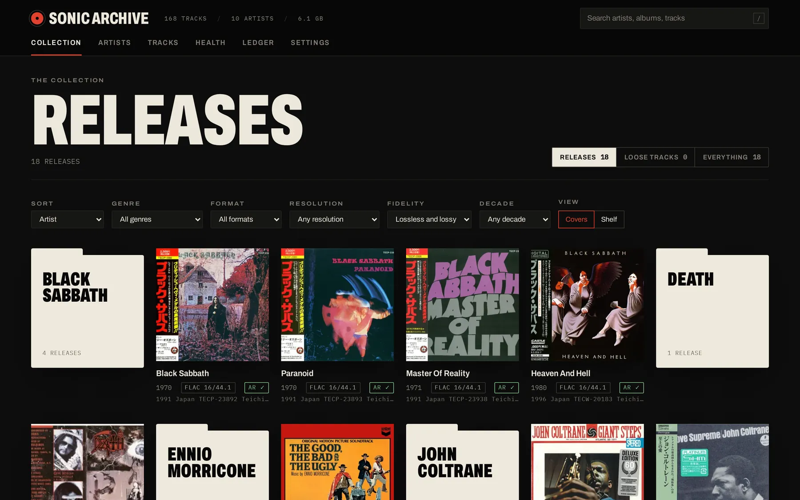
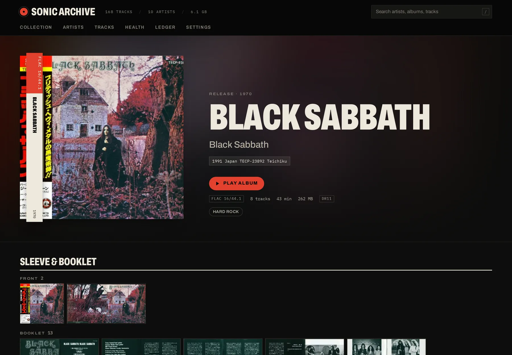
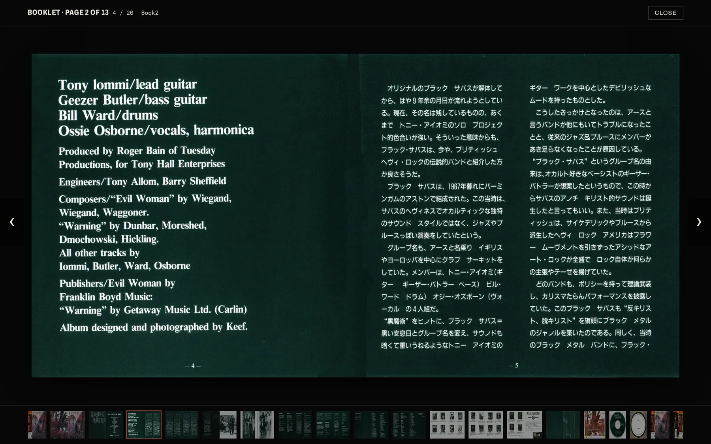
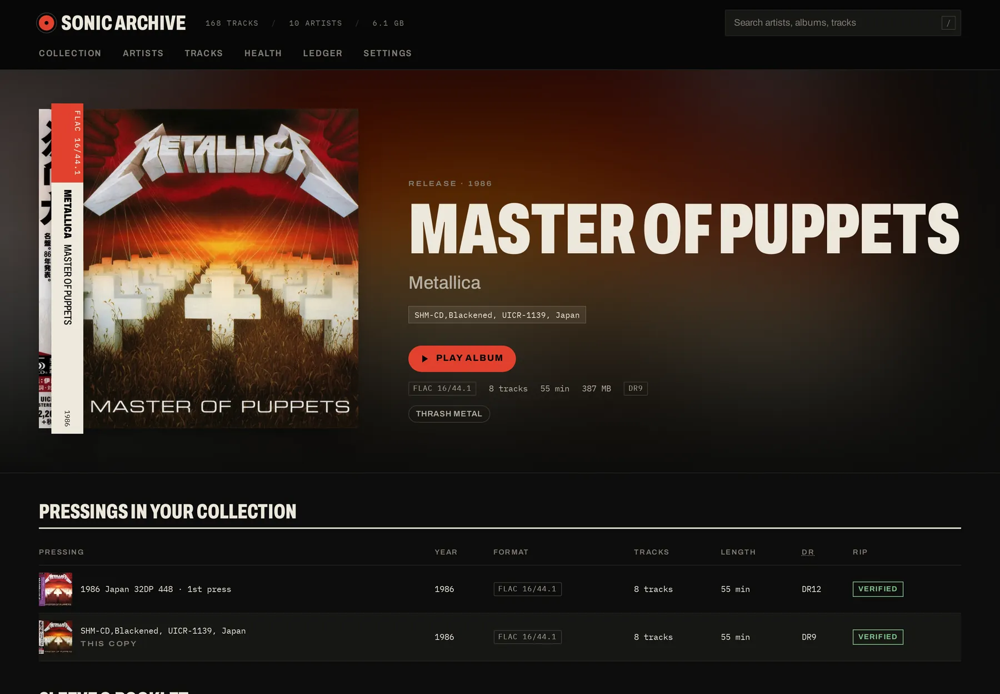
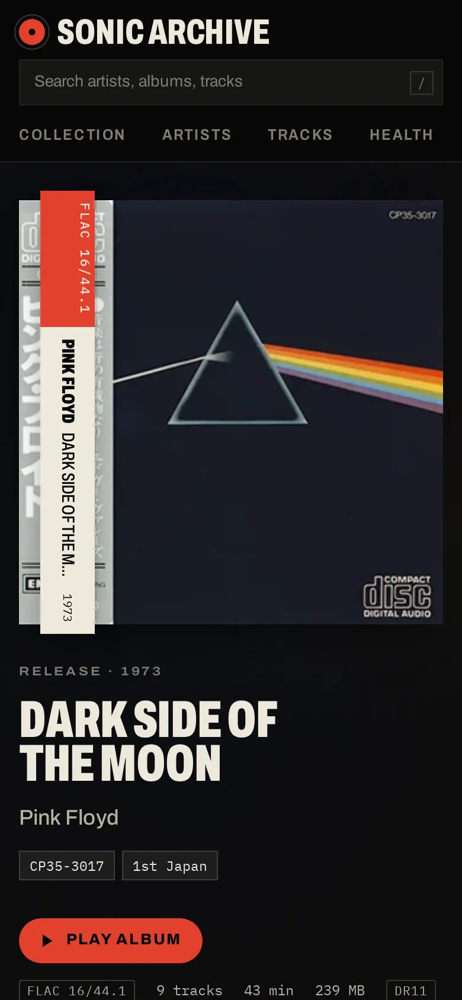
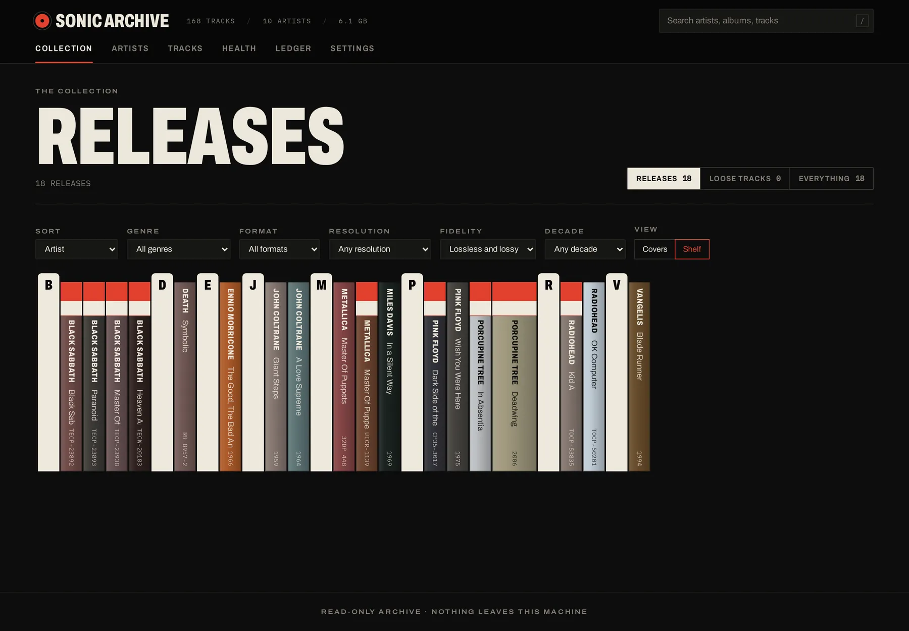
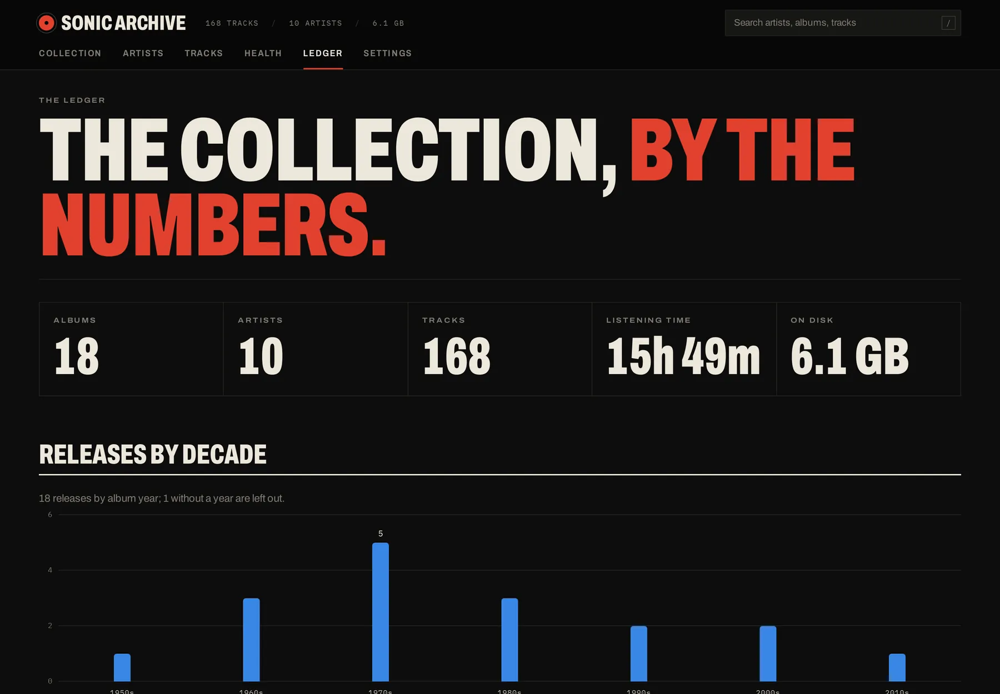

# Sonic Archive

A catalog for a lossless CD collection, made by someone who keeps the OBI
strips. Point it at your music folder and it shows each album the way it
sits on your shelf: the pressing and its catalogue number, the scanned
booklet, what the rip log says, how it compares with your other copy, and
how much dynamic range survived the mastering. It runs on your own computer,
and it never writes to your music.

<p align="center">
  
</p>

**Status:** v0.1.0, the first release. It's made for one person's
collection on one computer, and it works well for that. See
[CHANGELOG.md](CHANGELOG.md).

## Features

- **Album first.** Covers grouped by artist, with format, resolution, a
  verified-rip badge and the pressing under each. Filter by genre, format,
  resolution, fidelity or decade, or put the collection on a **shelf** of
  CD spines in their covers' colors, with OBI bands on Japanese pressings.
- **Sleeve & booklet.** Scans in the album folder (front, booklet, back,
  tray, disc, OBI) are sorted into a contact sheet and open in a full-screen
  viewer for reading liner notes.
- **Rip verification.** EAC (English, Russian or Spanish), XLD and CUETools
  logs are read for AccurateRip and CUETools-database results, read errors
  and CRCs. Each album gets a verdict, and the full log is a click away.
- **Pressings side by side.** Two copies of one album (a 1986 Japanese first
  press and an SHM-CD reissue, say) are compared by year, format, length,
  dynamic range and rip verdict.
- **Dynamic range.** Each track is measured with the DR meter used by the
  Dynamic Range Database, and shown per album, per pressing and per decade.
- **CD images handled properly.** A single-file image is split into its
  tracks by its CUE sheet, and the discs of a set join into one album.
- **Playback.** Albums play in the browser, CD images gapless as one stream.
  ALAC, APE, WavPack, DSD and AIFF are converted to FLAC while playing.
- **The Ledger and health.** Statistics for the whole collection, and a
  report of missing or unreadable files, metadata gaps, missing artwork,
  duplicates and rips that don't check out.
- **Always up to date.** The music folder is watched while the app runs:
  new rips and retags show up within seconds, and open pages refresh.
- **Quick search** from anywhere with `/` or Ctrl-K.

<p align="center">
  
</p>

<p align="center">
  
</p>

<p align="center">
  
  &nbsp;
  
</p>

<p align="center">
  
  &nbsp;
  
</p>

## Your music is only read

The music folder is treated as irreplaceable. No file in it is ever
modified, moved, renamed, deleted or retagged, and nothing is written inside
it; the catalog and its caches live in your own data folders. All access
goes through one read-only module, and tests fail if anything that touches
the library could write. [docs/safety.md](docs/safety.md) lists every rule
and how it's enforced.

## Requirements

- **Node.js 26** and **pnpm 12**. With [mise](https://mise.jdx.dev),
  `mise install` sets up both.
- **[ffmpeg](https://ffmpeg.org)** (optional), for dynamic range and for
  playing formats browsers can't (ALAC, APE, WavPack, DSD, AIFF). Without
  it, everything else works.
- Linux. macOS should work but isn't tested yet; Windows isn't supported.

It reads FLAC, ALAC, WAV, AIFF, APE, WavPack, DSD, MP3, AAC, Ogg Vorbis and
Opus, with
tags, embedded pictures, folder art (JPEG, PNG, TIFF), CUE sheets and rip
logs.

## Install and run

```sh
git clone https://github.com/sarwar-uddin/sonic-archive.git
cd sonic-archive
mise install            # or install Node 26 and pnpm 12 yourself
pnpm install
pnpm start              # builds, then serves http://127.0.0.1:4317
```

Open <http://127.0.0.1:4317>. On first run it asks where your music is:
browse to the folder (or paste its path) and choose it. It's scanned in the
background, then kept up to date while the app runs; covers, scans, rip logs
and dynamic range follow. **Settings** changes the folder, rescans, or stops
watching.

Sonic Archive only listens on `127.0.0.1`, so it's reachable from your
computer and nowhere else.

## How it reads your folders

Any layout works; these are the conventions it understands:

- **One album per folder.** Disc folders (`CD1`, `Disc 2of2`, `CD 1 (…)`)
  join their parent into one album, and so do the discs of a CD image set.
- **Pressing details from folder names:** `1986 Japan 32DP 448 (1st press)`
  or `[SHM-CD, UICR-1139, Japan]` become the album's pressing, catalogue
  number and country. Two folders of one album are two pressings.
- **Scans** next to the audio or in `Artwork/`, `Scans/`, `ART/` and the
  like, named in English, Spanish, Italian or French (`cover`, `front`,
  `booklet 03`, `obi`, `portada`…).
- **Rip logs** (`.log`, `.accurip`) in the album or disc folder.

The **Health** page lists what it couldn't make sense of.

## Command line

| Command                  | What it does                                                                                           |
| ------------------------ | ------------------------------------------------------------------------------------------------------ |
| `pnpm paths`             | Where config, the catalog and the cache live                                                           |
| `pnpm scan`              | Shows what a scan would do; with `--confirm` scans (`--dry-run`, `--subpath "Artist/Album"`, `--full`) |
| `pnpm analyze --confirm` | Measures dynamic range for tracks not yet measured                                                     |

## Your data

Sonic Archive follows the XDG folders:

- `~/.config/sonic-archive/config.json`: the music folder and settings
- `~/.local/share/sonic-archive/sonic.db`: the catalog (SQLite), with a
  backup before each upgrade
- `~/.cache/sonic-archive/`: cover and scan copies; if deleted, Settings →
  **Re-read every file** rebuilds them

Deleting these folders removes everything the app made, and never anything
of yours.

## Configuration

Environment variables, all optional:

| Variable             | Default                          |                                                 |
| -------------------- | -------------------------------- | ----------------------------------------------- |
| `SONIC_PORT`         | `4317`                           | Port for `pnpm start`                           |
| `SONIC_LIBRARY_ROOT` | (chosen in the app)              | Fixes the music folder; the app can't change it |
| `SONIC_CONFIG_DIR`   | `$XDG_CONFIG_HOME/sonic-archive` | Config                                          |
| `SONIC_DATA_DIR`     | `$XDG_DATA_HOME/sonic-archive`   | Catalog                                         |
| `SONIC_CACHE_DIR`    | `$XDG_CACHE_HOME/sonic-archive`  | Cover and scan copies                           |

## Development

```sh
pnpm dev      # API on :4317 and the web app with hot reload on http://127.0.0.1:5173
pnpm check    # typecheck, lint (Biome) and tests (Vitest)
```

[docs/development.md](docs/development.md) covers the layout, the API and
schema changes; design decisions are in [docs/adr](docs/adr).

## Security

Sonic Archive is built for one person on their own computer. It listens on
loopback only, refuses requests from other websites, and sends nothing
anywhere: no telemetry, no online lookups. See [SECURITY.md](SECURITY.md).

## License

[MIT](LICENSE) © 2026 Sarwar Uddin
